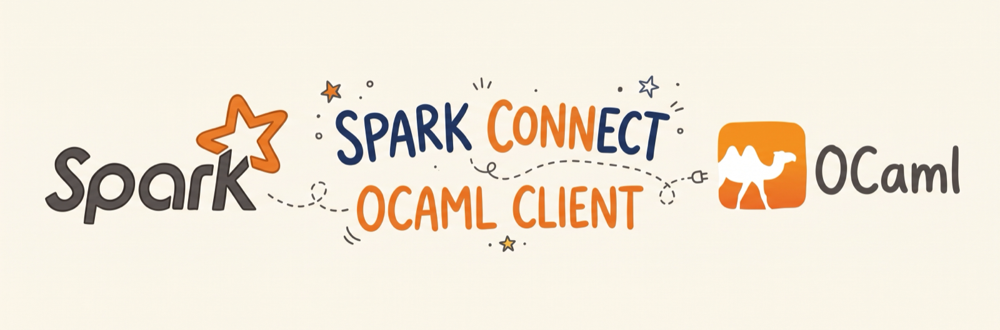
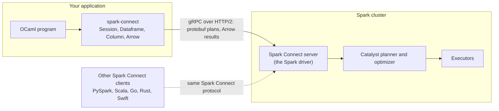
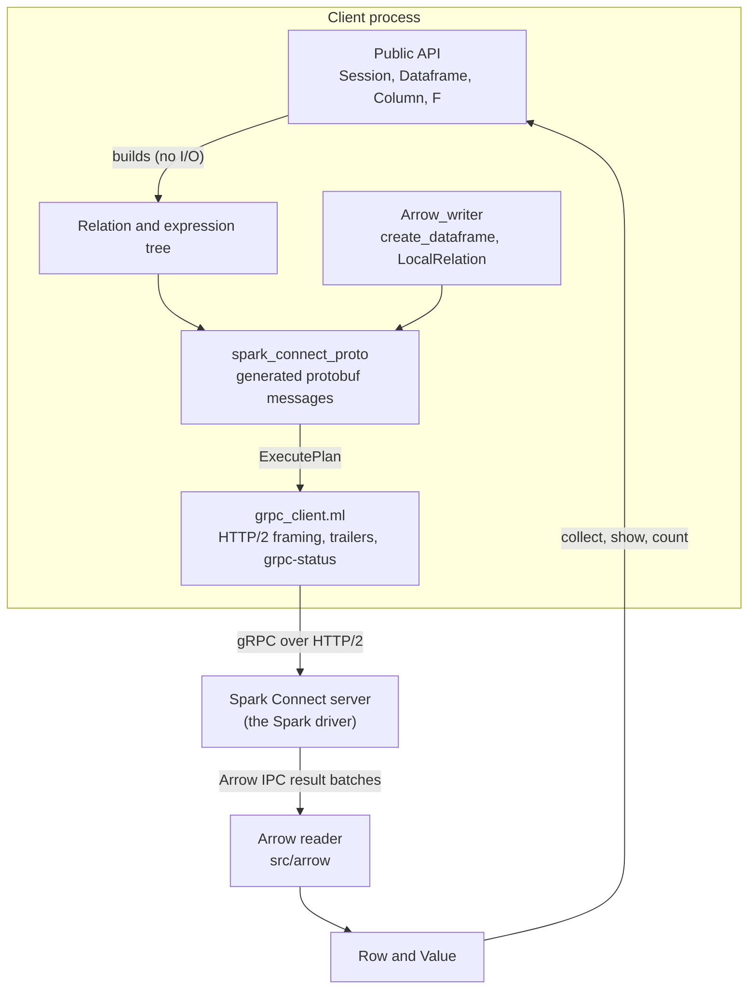

# spark-connect for OCaml

<p align="center">
  
</p>

[](https://github.com/lisancao/spark-connect-ocaml/actions/workflows/ci.yml)
[](https://github.com/lisancao/spark-connect-ocaml/actions/workflows/integration.yml)


[](https://github.com/lisancao/spark-connect-ocaml/actions/workflows/docs.yml)

Run Apache Spark from OCaml. This client connects to a Spark server, lets you
build DataFrames and run SQL from ordinary OCaml, and leaves the heavy lifting
on the cluster. It is pure OCaml, with no JVM or Arrow C library to install, and
it speaks the same protocol as PySpark.

**Documentation:** <https://lisancao.github.io/spark-connect-ocaml/> — guides and the API reference.

A client for [Spark Connect](https://spark.apache.org/docs/latest/spark-connect-overview.html),
the gRPC protocol that lets a thin client build DataFrame plans and run them on a
remote Apache Spark server. Written in OCaml end to end: HTTP/2 via `h2`,
protobuf via `ocaml-protoc`, and an Arrow IPC reader and writer included in the
package, so there is no C dependency on libarrow or on a JVM.

Works against any Spark 4.x server that exposes a Spark Connect endpoint. It is
tested against Spark 4.1.3, 4.2.0 and 4.3.0-rc1 (the release candidate);
[Compatibility and coverage](#compatibility-and-coverage) has the version matrix
and [docs/protocol-coverage.md](docs/protocol-coverage.md) the per-test results.

```ocaml
open Lwt.Infix
open Spark_connect

let () =
  Lwt_main.run begin
    Session.connect "sc://localhost:15002" >>= fun spark ->
    Session.sql spark "SELECT id, id * id AS sq FROM range(10)" >>= fun df ->
    let big = Dataframe.filter df Column.O.(Column.col "sq" > Column.int 20) in
    Dataframe.show big >>= fun () ->
    Dataframe.collect big >>= fun rows ->
    List.iter (fun r -> print_endline (Row.to_string r)) rows;
    Session.close spark
  end
```

## Architecture

Spark Connect splits the work: a thin client builds a plan and streams it to a
server, which plans and runs it. This client sits on the client side of that
split, alongside the PySpark, Scala, Go, Rust and Swift clients.



Inside the client, DataFrame operations only build the plan. Nothing touches the
network until an action runs.



More on the modules and the wire format is in [Design notes](#design-notes).

## Requirements

- OCaml 5.0 or newer, with opam.
- A Spark 4.x Connect server to talk to. The [Tests](#tests) section shows the
  one-command Docker setup used by CI.

## Install

```sh
opam pin add spark-connect https://github.com/lisancao/spark-connect-ocaml.git
```

Or from a checkout:

```sh
opam install . --deps-only --with-test
dune build
dune install
```

This also installs `sparkc`, a small SQL runner:

```sh
sparkc -r sc://localhost:15002 -e "SELECT current_timestamp(), version()"
sparkc --json -n 5 -e "SELECT * FROM my_table"
echo "SHOW TABLES;" | sparkc --csv
sparkc            # interactive; statements end with ';'
```

`SPARK_REMOTE` sets the default URL, as in PySpark.

## Connecting

The connection string follows the Spark Connect spec:
`sc://host[:port]/;param=value;...`. Supported parameters: `token` (sent as a
bearer `authorization` header and switching TLS on), `use_ssl`, `user_id`,
`session_id`, `user_agent`, and any `x-*` parameter, which becomes a request
header. Port defaults to 15002.

```ocaml
(* a bearer token plus an extra x-* request header *)
Session.connect "sc://spark.example.com:443/;token=abc;x-request-id=42"

(* explicit arguments override the string *)
Session.connect ~token:(Sys.getenv "SPARK_CONNECT_TOKEN") ~user_id:"lisa" "sc://spark.example.com:443"
```

TLS certificate validation uses the system trust store through `ca-certs`.
A hostname that resolves to several addresses, such as `localhost` on a
dual-stack host, is tried in turn until one connects.

## A real job

[`examples/nyc_taxi.ml`](examples/nyc_taxi.ml) runs a batch job over a month of
NYC yellow-cab trips (about 3 million rows): it reads Parquet and CSV, cleans
and derives columns, joins the zone lookup, aggregates, ranks zones per borough
with a window function, writes Parquet and reads the results back.
[`examples/nyc_taxi/README.md`](examples/nyc_taxi/README.md) brings up a
standalone Spark cluster (a master and two workers) with Docker and shows a run.

## What's in the box

| Module | Purpose |
|---|---|
| `Session` | connect, `sql` (with `:named` and `?` parameters), `range`, `table`, `read` (parquet, csv, json, orc, text, jdbc, any format), `create_dataframe`, `Conf`, `Catalog`, interrupts, `version`, `fetch_error_details`, `close` |
| `Dataframe` | `select`, `filter`, `with_column(s)`, `drop`, rename, `join` (all join types, `join_using`, self-joins via `Dataframe.col`), set operations, `group_by` / `rollup` / `cube` / pivot, `sort`, `limit`, `offset`, `sample`, `distinct`, NA handling, `describe`, `summary`, `unpivot`, `transpose`, hints, repartitioning, `persist` |
| actions | `collect` (rows), `collect_columns` (columnar), `count`, `head`, `take`, `tail`, `show`, `show_string`, `html_string`, `schema`, `columns`, `dtypes`, `print_schema`, `explain`, `input_files`, `is_local`, `same_semantics` |
| writers | `Dataframe.write` (format, mode, options, partition/bucket/cluster by, `save`, `save_as_table`, `insert_into`) and `write_to` (DataSource v2 modes), temp and global views |
| `Column` | `col`, literals, `expr`, `fn` for any SQL function, arithmetic and comparison operators (module `O`), `alias`, `cast`, sort orders with null ordering, `when_`/`otherwise`, `isin`, `like`, `get_item`, `get_field`, `with_field`, `over` with `Window` specs, `lambda` |
| `F` | the common Spark functions by name: aggregates, strings, math, dates, collections, higher-order functions, JSON, window functions |
| `Value` / `Row` | decoded results: ints, floats, strings, binary, decimals as strings, dates, times, timestamps with unit and zone, intervals, lists, structs, maps |
| `Arrow` / `Arrow_writer` | the Arrow IPC stream codec, usable on its own |
| `Error` | `Spark_error` with gRPC code, message, Spark error class, SQLSTATE, JVM exception classes, and an error id for `fetch_error_details` |
| `Proto` | the generated protobuf types, for anything the high-level API does not cover (`Dataframe.of_relation` accepts a raw relation) |

Everything is Lwt-based. All DataFrame transforms are pure plan construction;
only actions talk to the server.

## Compatibility and coverage

Tested against these Spark servers; the client speaks the Spark 4.x Connect
protocol, so the version gap is small.

| Spark server | Verification |
|---|---|
| 4.1.3 | integration suite, run in CI |
| 4.2.0 | integration suite, run in CI |
| 4.3.0-rc1 | integration suite, tested against the 4.3.0 release candidate; not in CI (no Docker Hub image yet) |

[docs/protocol-coverage.md](docs/protocol-coverage.md) lists every relation, expression, literal
type, command, catalog call, analyze request and config operation in the Spark
Connect protocol, whether the client implements it, which function builds it,
and whether a test exercises it, plus the integration suite's results per Spark
version. It's generated, not hand-written:

```sh
dune build
python3 scripts/coverage_matrix.py --remote 4.2.0=sc://localhost:15002   # one --remote per server
```

Everything the client implements is covered by a test. What it doesn't
implement yet is below.

## Not covered yet

- Reattachable execution (`ReattachExecute` / `ReleaseExecute`). Plain
  `ExecutePlan` is used, which Spark 4 servers fully support; very long queries
  over flaky networks will not resume after a dropped connection.
- Dictionary-encoded and compressed Arrow batches (Spark does not send these by
  default; the reader raises `Arrow.Unsupported` if it meets one).
- User-defined functions, Structured Streaming, MLlib and pipeline commands.
  The protos are generated, so the raw messages are available through `Proto`.
- Artifact upload (`AddArtifacts`).

## Design notes

- `src/grpc_client.ml` is a minimal gRPC client on top of `h2`: length-prefixed
  framing, trailers for status, `grpc-status-details-bin` decoding for Spark's
  rich errors. Unary and server-streaming calls only, which is all the
  protocol needs.
- The protos are vendored from the Spark repository (`proto/README.md`) and
  compiled at build time. Two small ocaml-protoc code generation quirks are
  patched by `src/proto/fixup` after generation.
- `src/arrow` is a self-contained Arrow IPC implementation: a FlatBuffers
  reader and builder, the streaming framing, and column decoders for the types
  Spark produces. `Arrow_writer` output validates with `pyarrow`'s full
  validation and is what `Session.create_dataframe` sends as a `LocalRelation`.
- Plan ids are assigned to every relation so that `Dataframe.col df "x"`
  resolves against a specific side of a self-join, as in the official clients.

## Tests

```sh
dune test                      # Arrow codec and unit tests, no server needed
```

Integration tests need a server. Spark's official image works out of the box:

```sh
docker run -d --name spark-connect -p 127.0.0.1:15002:15002 \
  --entrypoint /opt/spark/sbin/start-connect-server.sh \
  apache/spark:4.2.0-scala2.13-java21-python3-ubuntu --wait
SPARK_REMOTE=sc://localhost:15002 dune test
```

The suite pins `spark.sql.session.timeZone` to UTC where it compares timestamps,
so it passes whatever zone the server runs in.

The Arrow fixtures in `test/fixtures` were produced with `pyarrow` and cover
every Arrow type the reader handles, plus multi-batch, legacy framing, empty,
dictionary and compressed streams.

## Contributing

Bug reports and pull requests are welcome at
[lisancao/spark-connect-ocaml](https://github.com/lisancao/spark-connect-ocaml).

```sh
opam install . --deps-only --with-test
dune build @fmt        # formatting is checked in CI
dune test              # unit tests only; see Tests above for the integration suite
```

[`ci.yml`](.github/workflows/ci.yml) builds and tests on every OCaml version
from 5.0 to 5.3 and checks formatting;
[`integration.yml`](.github/workflows/integration.yml) runs the integration suite
against Spark 4.1.3 and 4.2.0 servers started with Docker. `docs/protocol-coverage.md` is
refreshed by hand from
[`coverage.yml`](.github/workflows/coverage.yml).

## License

Apache License 2.0. The vendored protobuf files are copyright the Apache
Software Foundation, under the same license.
