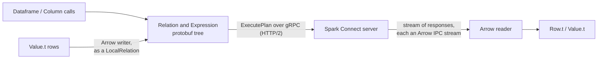

# Architecture

The client turns DataFrame calls into protobuf plans, sends them over gRPC, and decodes
the Arrow that comes back. It never resolves a name or optimizes anything; that's the
server's job.

## Layout

| Path | Role |
|---|---|
| `src/grpc_client.ml` | a minimal gRPC client on `h2`: length-prefixed framing, status from trailers, `grpc-status-details-bin` decoding for Spark's rich errors; unary and server-streaming calls, which is all the protocol needs |
| `src/client.ml` | session identity, request construction, plan ids, the RPCs |
| `src/session.ml`, `src/dataframe.ml`, `src/column.ml`, `src/functions.ml` | the public API |
| `src/arrow/` | a self-contained Arrow IPC implementation: a FlatBuffers reader and builder, stream framing, and decoders and encoders for every type Spark produces |
| `src/proto/` | OCaml bindings generated at build time by `ocaml-protoc` from the vendored protos, plus a fixup pass for two code generation quirks |
| `proto/` | the Spark Connect protos, vendored from the Spark repository (see `proto/README.md`) |
| `bin/sparkc.ml` | the SQL runner |

## Design notes

- **Plans are values.** A `Dataframe.t` is a relation tree; transformations build a new
  tree and never touch the network. Actions send the tree in one `ExecutePlan` call.
- **Plan ids.** Every relation gets a client-assigned plan id, so `Dataframe.col df "x"`
  can bind a column to one side of a self-join, as in the official clients.
- **Server-side formatting.** `show` sends a `ShowString` relation and prints the
  string the server formatted, so tables look exactly like PySpark's.
- **No C dependencies.** HTTP/2, TLS, protobuf and Arrow are all pure OCaml, so the
  client builds anywhere OCaml does.
- **Errors.** Spark's `ErrorInfo` (error class, SQLSTATE, exception classes, error id)
  is decoded from the gRPC status details into `Spark_error`.
