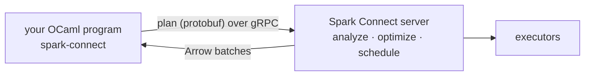

# Spark Connect for OCaml

A pure-OCaml client for [Apache Spark Connect](https://spark.apache.org/docs/latest/spark-connect-overview.html):
build DataFrame queries in OCaml and run them on a remote Spark server.

There is no JVM and no Spark installation on the client, and no C dependencies either:
HTTP/2 comes from `h2`, protobuf from `ocaml-protoc`, and the Arrow IPC reader and
writer are part of the package. All you need is a reachable Spark Connect server.

```ocaml
open Lwt.Infix
open Spark_connect

let () =
  Lwt_main.run
    ( Session.connect "sc://localhost:15002" >>= fun spark ->
      let open Column.O in
      Session.range ~start:1L spark 1000L |> fun d ->
      Dataframe.select d [ Column.col "id"; Column.col "id" % Column.int 3 @= "bucket" ] |> fun d ->
      Dataframe.group_by d [ Column.col "bucket" ] |> fun g ->
      Dataframe.Grouped.agg g [ F.count_all () @= "n"; F.sum (Column.col "id") @= "total" ] |> fun d ->
      Dataframe.show (Dataframe.sort d [ Column.col "bucket" ]) >>= fun () ->
      Session.close spark )
```

```
+------+---+------+
|bucket|  n| total|
+------+---+------+
|     0|333|166833|
|     1|333|166167|
|     2|333|166500|
+------+---+------+
```

## What is Spark Connect?

Classic Spark runs your driver inside the cluster's JVM. Spark Connect splits it out:
your program is a thin client that builds an unresolved logical plan and sends it to a
Spark Connect server over gRPC. The server analyzes, optimizes and runs it, then
streams the results back as [Apache Arrow](https://arrow.apache.org/) batches.



Because the protocol is language-neutral, a client can be written in any language.
This is the one for OCaml.

## What it supports

- `Session`: connect, SQL with named and positional parameters, `range`, tables,
  readers for every built-in format, `create_dataframe` from OCaml values, runtime
  configuration, the catalog, and interrupts.
- `Dataframe`: projections, filters, joins (including self-joins), set operations,
  grouping with `rollup`, `cube` and pivots, sorting, sampling, NA handling,
  `describe`/`summary`, `unpivot`, `transpose`, hints, repartitioning, persistence,
  and writers (v1 and v2).
- `Column` and `F`: the expression algebra, window specifications, lambdas for
  higher-order functions, and the common Spark functions by name; anything else is
  one `Column.fn "name" args` away.
- Rich errors: Spark's error class, SQLSTATE and exception chain on every failure.

The integration suite passes against Spark 4.1, 4.2 and 4.3.0-rc1. See
[API coverage](api-coverage.md) for exactly what is and isn't implemented, and
[Protocol coverage](protocol-coverage.md) for the generated, message-by-message matrix.

## Where to go next

- [Installation](installation.md) and starting a Spark Connect server
- [Quickstart](quickstart.md)
- [Examples](examples.md), including a batch job over a month of NYC taxi data on a
  standalone cluster
- The [API reference](https://lisancao.github.io/spark-connect-ocaml/api/spark-connect/), generated by odoc
